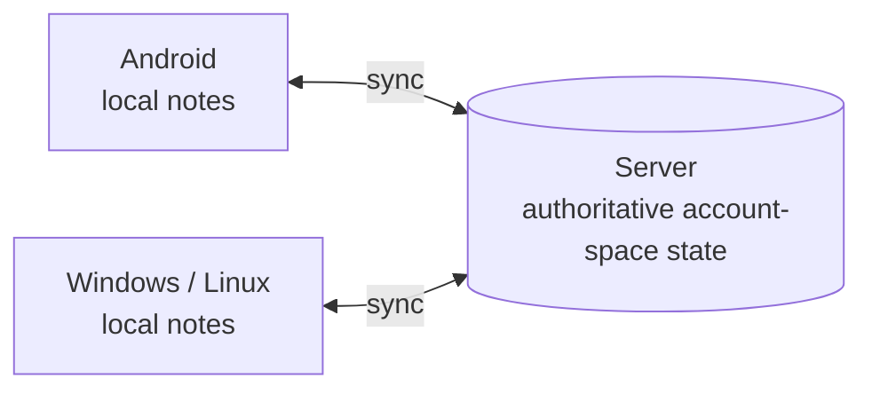
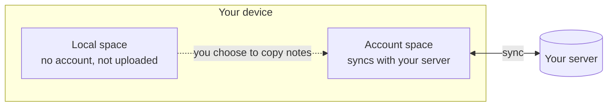
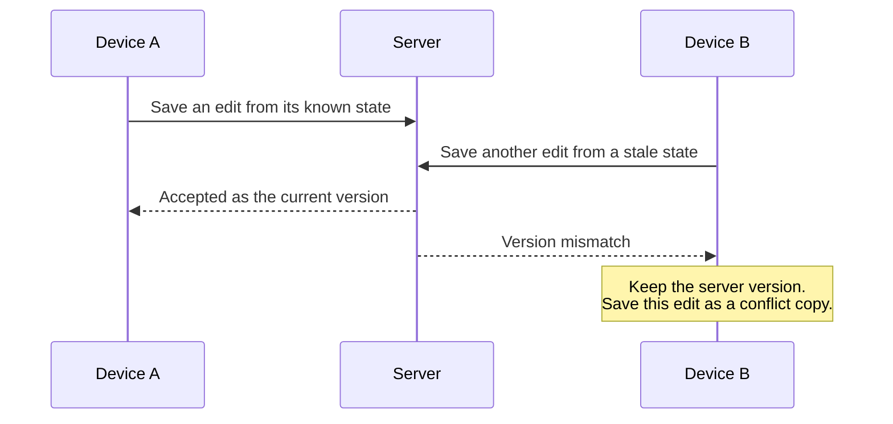

# DJHX MEMO

**阳墨随记**

<!-- UPDATE: Before each release, verify the supported platforms, tagline, badge, and download table against the current release assets. -->

Write first, sync later. 
A local-first Markdown notebook for Windows, Linux and Android.

English | [简体中文](README.zh-CN.md)

[Website](https://memo.djhx.site/) · [Download](https://github.com/Koril33/djhx-memo/releases/latest)

## What is DJHX MEMO?

DJHX MEMO is a Markdown notebook built around one idea: your notes belong on your own device first. Open the app and start writing; no account or network connection is required. When you want the same account-space notes on more than one device, connect to a sync server and sync them across Windows, Linux and Android.

## Highlights

- **Local-first.** Notes are stored on your device. Writing, searching, trash and export work offline.
- **Markdown, rendered safely.** Edit the source or preview it, tick task-list items in the preview, and highlight code offline. Raw HTML is shown as text, and external images are not loaded automatically.
- **Conflicts stay visible.** When two devices edit the same note from different versions, the server keeps its current version and saves the incoming edit as a separate conflict copy.
- **Two separate spaces.** Notes in the local space stay on the device. Moving them to an account space is an explicit copy that you choose to make.
- **Portable notes.** Export a space as a Markdown ZIP archive, or import one Markdown file at a time.
- **Self-hostable sync.** Cloud sync uses a small server that you can run yourself.
- **Everyday comforts.** English and Simplified Chinese UI, light and dark themes, a desktop system tray, and a native Android app.

## How it works

### Local first, sync second

Each device reads and writes its local data, so notes remain available offline. When connected, devices exchange changes with the server, which makes account-space changes available to your other devices and keeps the authoritative state.

### Local space and account space

Without an account, you work in the local space and its notes are not uploaded. Signing in gives you a separate account space. Importing notes from the local space copies them into the account space; the original notes stay in the local space, and later edits do not link the two copies.

### When two devices edit the same note

If a note changed on the server since a device last saw it, the server keeps its current version and saves the incoming edit as a separate, editable conflict copy. You can then review and merge the two versions yourself.

### Markdown rendering

Notes are plain Markdown text. Edit the source or switch to the preview, and tick task-list items in the preview; only the matching task marker in the source changes. Fenced code blocks are highlighted offline. For safety, raw HTML is displayed as text, external images are not loaded automatically, and allowed web links open in your system browser.

## Download

Get the latest available installers from [GitHub Releases](https://github.com/Koril33/djhx-memo/releases/latest). Check the download against the `SHA256SUMS` file on its release page.

| Platform | Package |
| --- | --- |
| Windows (x64) | Installer (`.exe`) |
| Linux (amd64) | Debian package (`.deb`) |
| Android | APK |

<!-- UPDATE: Review client availability before each release; revise this sentence if macOS, iOS, or web clients become available. -->

There are currently no macOS, iOS or web clients.

## Cloud sync and self-hosting

<!-- UPDATE: Before each release, verify the end-to-end encryption statement against the product's current security model. -->

Cloud sync requires a server. You can use the configured server or run your own. Account-space notes are sent to that server, which can read their contents; end-to-end encryption is not available.

<!-- UPDATE: Before each release, verify the default server address and registration policy. -->

The app currently pre-fills `https://memo.djhx.site` as its server address. Registration requires a one-time invitation; open public registration is not available.

To use your own server:

1. Deploy the server, a small Go program backed by SQLite. See the documentation index below for the operations guide.
2. Create an invitation with the server's administrative command.
3. In the app's account settings, enter your server's HTTPS address and register with the invitation.

## Documentation

Guides for getting started, self-hosting and the project's technical reference are indexed in [docs/](docs/README.md).

## License

[MIT](LICENSE). Third-party dependencies, icons and installer templates retain their own licenses; see the documentation index above for details.
