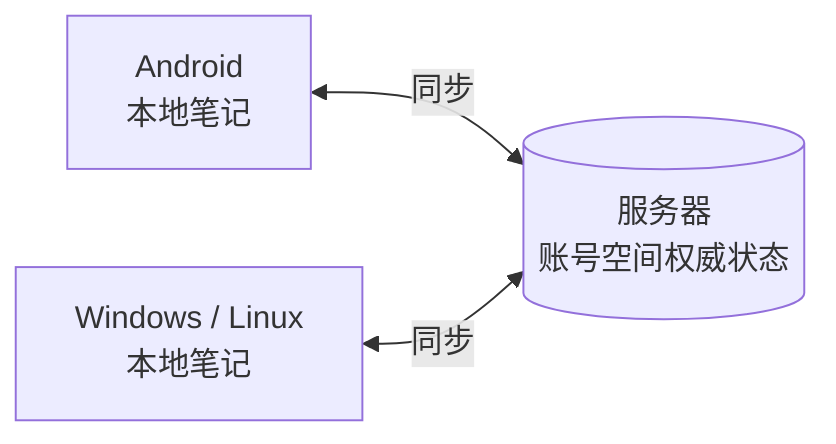
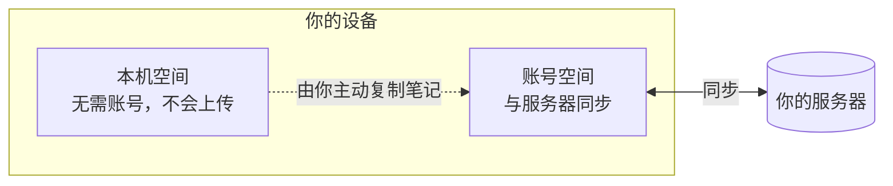
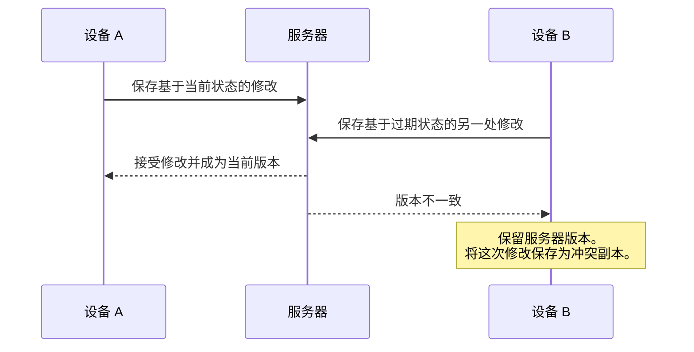

# 阳墨随记

**DJHX MEMO**

<!-- UPDATE: 每次发版前依据当前发行物，复核支持平台、简介、平台徽章和下载表格。 -->

先记下来，再同步。 
本地优先的 Markdown 备忘录，支持 Windows、Linux 和 Android。

[English](README.md) | 简体中文

[官网](https://memo.djhx.site/) · [下载](https://github.com/Koril33/djhx-memo/releases/latest)

## 这是什么？

阳墨随记是一款围绕一个理念设计的 Markdown 备忘录：笔记首先属于你自己的设备。打开应用就能开始写，不需要账号或网络连接。想在多台设备上使用同一账号空间里的笔记时，连接同步服务器即可在 Windows、Linux 和 Android 之间同步。

## 特点

- **本地优先。** 笔记保存在本机，写作、搜索、回收站和导出都可以离线使用。
- **安全的 Markdown 渲染。** 可以编辑源码或查看预览，在预览中勾选任务清单，代码块支持离线高亮。原始 HTML 只作为文本显示，也不会自动加载外部图片。
- **冲突内容清楚保留。** 两台设备基于不同版本编辑同一条笔记时，服务器保留当前版本，并将收到的修改保存为单独的冲突副本。
- **本机空间与账号空间分离。** 本机空间中的笔记留在设备上；只有你主动选择复制，才会进入账号空间。
- **笔记方便带走。** 可以将一个空间导出为 Markdown ZIP，也可以一次导入一个 Markdown 文件。
- **可以自建同步服务。** 云同步使用小型服务端，你可以自行部署。
- **日常细节。** 支持简体中文和 English 界面、浅色和深色主题、桌面系统托盘，以及 Android 原生应用。

## 工作原理

### 先本地，再同步

每台设备都直接读写本地数据，因此离线时也能使用笔记。联网后，设备与服务器交换变更；服务器将账号空间的变更提供给其他设备，并保存权威状态。

### 本机空间与账号空间

不登录时，你在本机空间里工作，笔记不会上传。登录后会得到独立的账号空间。从本机空间导入笔记时，应用会将它们复制到账号空间；原笔记仍留在本机空间，之后编辑两边的笔记也不会互相联动。

### 两台设备修改了同一条笔记

如果设备上次同步后服务器上的笔记又发生了变化，服务器会保留当前版本，并把收到的修改另存为一条可编辑的冲突副本。你可以自行查看并合并两个版本。

### Markdown 渲染

笔记就是普通的 Markdown 文本。你可以编辑源码或切换到预览，在预览中勾选任务清单时，只有源码中对应的任务标记会改变。围栏代码块支持离线高亮。出于安全考虑，原始 HTML 只作为文本显示，不会自动加载外部图片，允许的网页链接会交由系统浏览器打开。

## 下载

可以从 [GitHub Releases](https://github.com/Koril33/djhx-memo/releases/latest) 获取最新可用安装包。请使用发布页上的 `SHA256SUMS` 核对下载文件。

| 平台 | 安装包 |
| --- | --- |
| Windows (x64) | 安装程序（`.exe`） |
| Linux (amd64) | Debian 包（`.deb`） |
| Android | APK |

<!-- UPDATE: 每次发版前复查客户端平台范围；若 macOS、iOS 或 Web 客户端开放，更新本句。 -->

目前没有 macOS、iOS 或 Web 客户端。

## 云同步与自建服务器

<!-- UPDATE: 每次发版前依据产品当前安全模型复核端到端加密说明。 -->

云同步需要服务端。你可以使用应用预设的服务器，也可以自己部署。账号空间中的笔记会发送到服务器，服务器可以读取正文；目前不提供端到端加密。

<!-- UPDATE: 每次发版前核对默认服务器地址和注册方式。 -->

应用当前预填的服务器地址为 `https://memo.djhx.site`。注册需要一次性邀请码，目前不开放公开注册。

自建服务器的步骤：

1. 部署服务端：一个使用 SQLite 的小型 Go 程序。运维指南见下方文档索引。
2. 使用服务端管理命令生成邀请码。
3. 在应用的账号设置中填写服务器 HTTPS 地址，并使用邀请码注册。

## 文档

快速开始、自建服务和项目技术参考见 [docs/](docs/README.md) 文档索引。

## 许可证

[MIT](LICENSE)。第三方依赖、图标和安装器模板遵循各自的许可证，详情见上方文档索引。
