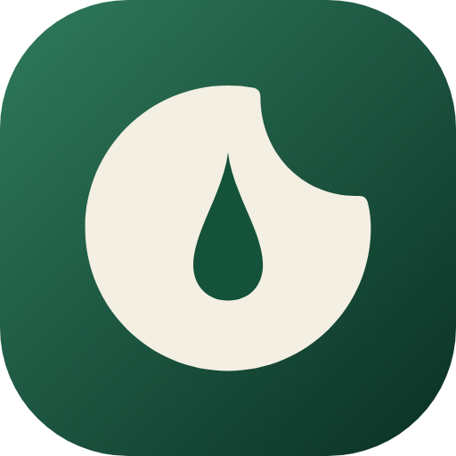

# jade-ivory 候选母版（2026-11-21）

- 状态：**维护者已于2026-11-21确认采用并授权多端生成/替换**。本目录保留最初候选来源；正式原样归档在[已确认母版](../../sources/jade-ivory-v1/README.md)，当前资源接入见[验证记录](../../../../docs/brand-jade-ivory-validation.md)。它不是遗失原件的恢复副本。
- [master.svg](master.svg)：新绘制的可编辑矢量母版，1120字节；SHA256 `1970cef1201bc15581156631df4c403c217626b92f7f30944b7e0d8296771cb4`。
- [reference-preview.png](reference-preview.png)：先前玉白设计的512×512参考预览，原样保留；[preview.png](preview.png)是新候选512×512渲染预览。文件大小/哈希见 [manifest.json](manifest.json)。

新母版以256×256坐标绘制，背景圆角72；主体外接宽约160.4，约占画布62.7%，保留参考图已放大的比例。背景为 `#2F7A5C → #0A3024` 对角渐变，主体玉白 `#F3EFE2`，墨滴 `#14523A`。圆形主体、右上内收曲线与中央墨滴用少量贝塞尔曲线重建，不含脚本、外部引用、嵌入位图或旧provenance声明。

参考原SVG的历史预期哈希为 `b597731e5496bb1cd92fac662950668948237bee8fdae93e110eda1c2ae81f65`，与此新文件不同；不宣称轮廓、渲染或元数据逐字节相同。维护者现已确认采用，目标规范与活动资源已切换到这个新来源。

预览用本机现有Edge headless渲染SVG并人工查看，仅供视觉讨论。预览白色角落是展示背景；SVG圆角外部透明。生产Android adaptive图层还需拆满幅背景/前景并适配安全区，桌面小尺寸/ICO、单色/托盘及官网也需按各自契约生成，不能直接把预览PNG复制到所有平台。

后续已完成统一资源接入，活动profile为jade-ivory-v1，68项输出校验通过；sunrise原63项完整归档，黑白托盘4项和兼容身份保持。本目录的PNG仍为最初视觉对照，不作为生产图层直接复制。接入遵守[品牌流程](../../../../docs/brand-change-workflow.md)和[0.2.0计划复审](../../../../docs/reviews/client-0.2.0-plan-review.md)，原生安装/线上部署另验。

