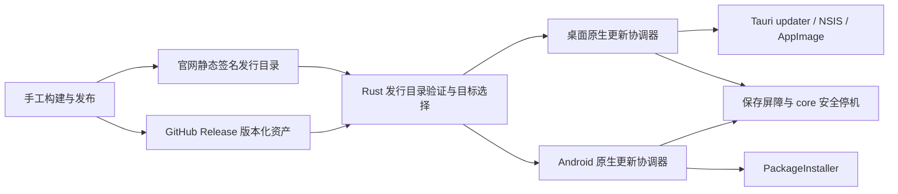

# Windows、Linux、Android 自动更新方案

- 设计日期：2026-11-11；实施更新：2026-11-12。**Windows/Android 已形成 0.1.5 候选实现，Linux 安装适配仍为提案**；实际检查见[0.1.5 验证](client-updates-0.1.5-validation.md)，发布见[操作说明](update-publishing.md)。
- 基于 `93b0f18` 的 0.1.4 开发代码；公开 Release 与当前实现能力仍以[发布记录](client-release.md)为准。
- 产品要求只在[更新提案规范](../spec/automatic-updates.md)定义；本文说明实现边界、发布方法与工程顺序。研究依据见[17 项调研](research/rust-gui-auto-update-survey.md)。

## 1. 推荐选择

| 目标 | 推荐方案 | 增量与主要约束 |
|---|---|---|
| Windows | 官方 `tauri-plugin-updater` + 现有 NSIS | 增加更新签名与原生协调器，保留 currentUser/历史安装兼容 |
| Linux 自动更新渠道 | 新增 AppImage + 同一 Tauri updater | 在 Linux 构建机打包并验收；需要运行依赖、可写路径与桌面集成验证 |
| Linux DEB | 保留系统安装渠道 | 先做发现与下载指引；真正自动安装需另外建设签名 APT 仓库 |
| Android | Compose UI + Rust 发行验证 + 原生 `PackageInstaller` | GitHub APK，同包名/同签名；用户授权和系统确认 |
| 元数据 | 官网静态签名目录 | 无账号 API、无常驻发布服务、无 CI/Runner 要求 |
| 安装包 | GitHub 版本化 Release 资产 | 保持现有分发；断网可手动下载/验证，不使用随机第三方代理 |

默认后台检查、非计费网络下载、用户决定安装时机。首期不引入增量补丁、远程强制更新、后台提权服务或多个发布通道。这是针对当前单维护者、三端、手工发布的建议；“全部平台相同的静默替换”不适合本项目。

## 2. 设计时的工程基线（2026-11-11）

| 已核实位置 | 当前状态 | 对方案的影响 |
|---|---|---|
| [desktop Cargo](../desktop/src-tauri/Cargo.toml) 与配置 | Tauri 2.12.5；没有 updater | 原生层新增插件，Svelte 展示状态；无需换 GUI 框架 |
| [桌面/Windows 配置](../desktop/src-tauri/tauri.conf.json)、[NSIS 模板](../desktop/src-tauri/windows/installer.nsi) | currentUser、兼容旧“简记”安装身份 | 保留安装路径、卸载注册信息及 `/UPDATE`、`/NS`、`/ARGS` 行为 |
| [Linux 配置](../desktop/src-tauri/tauri.linux.conf.json) | 当前只有 DEB | 不能对现有 DEB 宣称开启 Tauri 就能自升级 |
| [Android 构建](../android/app/build.gradle.kts) | 原生 Kotlin/Compose，UniFFI；包名 `app.djhx.memo`，versionCode 5；arm64-v8a/x86_64 | 不能用 Tauri mobile 插件代替原生实现；保持 universal APK，暂不拆 ABI |
| [Android manifest](../android/app/src/main/AndroidManifest.xml) | 当前无安装授权/安装会话集成 | 后续实现需明确增加权限与回调，不能视作已支持 |
| [删除规范](../spec/permanent-deletion.md)、[验证](client-updates-0.1.4-validation.md) | 协议 2；core schema 3；server schema 2 | 升级先后顺序、离线操作和不可逆删除标记必须保持 |
| [官网部署](website-deployment.md)、[发布](client-release.md) | 静态官网 + `/v1` Go API；GitHub 三端安装包 | 更新目录走独立静态路径，与笔记/账号服务隔离 |

现有 Windows 安装器未做 Authenticode 签名；APK 需要原有发布证书。Tauri 更新签名、Authenticode 和 APK 证书是三套职责，不可互换。历史 0.1.3/0.1.4 无更新器，U1 需一次人工覆盖升级。

## 3. 模块划分

现已新增 `core/src/update_catalog.rs` 与 UniFFI `UpdateService`：解析、验签、SemVer/序号比较、目标选择及设备偏好/缓存。实施时把匿名 HTTP 与限量流式下载也统一放进该独立模块，减少跨端重复；HTTP 对象不持有账号/token，不做笔记同步、不执行安装、不改变 note/outbox 数据模型。目录始终按**原始字节**验签。原生层负责网络计费判定、调度、保存屏障与系统安装。

桌面 `desktop/src-tauri/src/update.rs` 管理 Windows 安装；Android `AppUpdates/UpdateInstaller` 管理原生生命周期与会话。UI 只提交固定意图并读取状态，不能提交任意 URL、路径、shell 参数或公钥；安装器只接收原生层内部生成的候选句柄。

不把 updater 通用文件、shell、网络权限开放给 Markdown/WebView。原生命令校验主窗口来源和当前任务标识，拒绝过期句柄；一次只运行一条安装任务。多窗口、托盘事件和手动检查共享同一状态。

## 4. 静态发行目录与信任链

### 4.1 分发路径

建议静态入口 `https://memo.djhx.site/updates/stable/current.json`。这是**计划路径，尚未部署**；不经 Go 账号 API，不把客户端同步服务器地址拼成更新 URL。版本化快照放 `/updates/stable/catalog-<sequence>.json`，同时在 GitHub Release 附上相同目录文件用于人工核对。

入口为一个原子发布的签名信封，字段如下：

| 信封字段 | 含义 |
|---|---|
| `envelope_version` | 固定为 1；未知版本拒绝自动安装 |
| `key_id` | 只用于从本地信任表选择公钥，不能携带新信任根 |
| `payload_base64` | 发行目录原始 UTF-8 JSON 字节的 Base64 |
| `signature` | 对解码后原始字节的 Minisign 签名文本 |

先限制信封大小、字段和编码，后验签，再解析 payload；不通过 JSON 重排/重新序列化后验签，不自创加密算法。信封上限建议 1 MiB，解析拒绝重复关键字段、超深嵌套和未知必需 schema。签名和 payload 同一文件，避免分别覆盖两个文件导致版本错配；目录写临时文件后原子替换 `current.json`。HTTPS 仍须正常校验证书，不允许不安全传输开关。

离线发布工具可复用已有 Tauri CLI signer。须明确编码：Tauri `.sig` 文件/插件字段使用其规定的编码；目录信封的 `signature` 存解码后的 Minisign 文本，供 `minisign-verify::Signature::decode` 使用。工具负责转换并做往返验证，不混用“Base64 的签名文件”与“Minisign 的签名文本”，不额外依赖未审查签名程序。

### 4.2 Payload 要求

以下是供实现落实的字段契约提案，不是当前可调用 API，也不是带虚假签名的可发布示例。

| 字段 | 约束 |
|---|---|
| `schema_version` / `application_id` / `channel` | `1` / `app.djhx.memo` / `stable`；严格校验 |
| `sequence` | 十进制 u64 字符串，整个 stable 目录单调递增，避免 JS 整数精度丢失 |
| `issued_at` / `expires_at` | UTC RFC3339；建议有效期 30 天；无新版本时也定期重签新序号 |
| `targets` | 每个已就绪目标独立版本条目，未就绪目标不伪装新版 |
| `withdrawn` | 已撤回的版本/目标资产标识；更高序号发布撤回 |
| 目标身份 | OS、CPU/ABI、package format、安装渠道、应用标识 |
| 发行身份 | SemVer、tag、完整 source commit、更新说明、发布时间 |
| 资产身份 | 版本化 HTTPS URL、字节数、SHA-256；桌面另需 Tauri 包签名及 key id，APK 使用包内原生签名 |
| 兼容要求 | 最低 OS/minSdk、支持协议集合、可读写数据 schema 范围、最低 updater 版本 |
| Android 附加字段 | `applicationId`、`versionCode`、允许的发布签名证书 SHA-256、ABI 集合 |

目标键首期为 `windows-x86_64-nsis`、`linux-x86_64-appimage`、`linux-x86_64-deb`、`android-universal-apk`。增加目标需要构建和真实验收；不使用默认 Windows 资产兜底未知目标。

候选 `version/tag/hash/signature/URL` 必须作为一个不可变整体处理。链接指向 GitHub `releases/download/<固定 tag>/<固定资产名>`，不把 `/latest` 重定向当作安装身份。不依赖每台客户端查询 GitHub API，也不往客户端放访问 token。

只允许发行仓库和后续明确配置的自有镜像；URL 无 userinfo，不接收本地路径或命令。GitHub 下载允许其正常 HTTPS 资产 CDN 重定向，逐跳限制 HTTPS、次数与允许的 CDN 主机，不用脆弱的单个临时签名 URL 固定化。重定向后仍校验同一签名和哈希，不传账号 Authorization/cookie。

### 4.3 桌面如何使用已验证目录

候选版本、URL 与包签名由验证后的条目转换成 Tauri `RemoteRelease` 对应 JSON，再由 Rust `Updater::restore_update` 创建任务；不二次请求另一个 unsigned latest.json。固定 [updater 2.14.1 源码](https://github.com/tauri-apps/plugins-workspace/blob/updater-v2.14.1/plugins/updater/src/updater.rs)已核实该 API、`Update::verify` 与 `Update::install` 的包验证路径。

`restore_update` 会要求包签名的 trusted comment 绑定版本。构建启用 `createUpdaterArtifacts: true`；`tauri build` 生成版本签名，手动补签使用 `signer sign --app-version <版本>`。本机既有 CLI 的帮助已确认该选项；0.1.5 已完成真实 Windows 构建与签名互通检查；实际覆盖安装矩阵仍以验证记录为准。

下载后除 Tauri 验签外再核对目录中的大小/哈希；安装前重验。同样检查最终包内版本与目录声明。首期不承诺 HTTP Range 续传：下载中断重试整包，保证实现简单；后续若加续传，必须绑定 ETag/目标哈希并最终全量校验。

目录中的包大小不是无限授权。首期建议单资产硬上限 512 MiB，下载过程逐块计数，即使缺失/伪造 Content-Length 也不能无限接收；超限失败关闭。安装前检查暂存、替换及备份所需空间。Tauri 下载接口会持有完整包字节，桌面原型必须测峰值内存；若 AppImage 超出可接受预算，先调整包体或原生流式暂存适配，不声称默认插件已经实现低内存流式安装。Android 使用流式文件/会话，不把 universal APK 全部放进 Java 堆。

### 4.4 序号、时钟与密钥

持久化每通道最大已验证序号及原始 payload 摘要；相同序号不同内容、较低序号、候选不高于已安装版本均拒绝自动推广。时间仅用于更新目录有效性，不用于笔记排序。时钟异常/目录过期时暂停自动安装并提示，不禁用记笔记；人工安装仍须明确验证来源。

此方案是小型发行链的防篡改/回放设计，**不是完整 TUF 实现**：新装/状态被清空的客户端无法单凭序号证明拿到最新目录；静态入口离线也无法立即获得撤回信息。默认安装前重新获取有效目录；离线保留缓存与笔记，自动安装延后。30 天有效期意味着需维护重签提醒，漏签不会影响笔记功能。

目录签名钥与 Tauri 包签名钥分离保管，公钥随可信 U1 安装包内置；Android APK 仍用原证书。私钥在仓库外加密备份，发布机器仅在需要时取用；不把口令放命令行/聊天/日志。

轮换采用桥接版本：先用旧钥签发包含新公钥的客户端，再逐步切换到新钥。目录需有按目标和当前 updater 版本选择的 `bridge_releases`，保留旧客户端可安装的桥接包；有 `min_updater_version` 限制时必须先提供可执行的升级路径，不能只显示“要求更高更新器”。双签/信任表的具体格式在后续轮换实现 PR 冻结；0.1.5 不处理桥接字段。丢失旧钥需人工核验来源后覆盖安装；泄露钥下仅提高序号不能修复信任，需独立可信渠道换钥。APK 原签名钥丢失更可能影响原包名覆盖升级，必须优先保全。

## 5. 各平台安装

### 5.1 Windows

使用现有 NSIS currentUser，选 passive 显示进度；安装动作由“保存并重启更新”触发，不默认 silent。通过现有模板保持“简记”遗留注册/目录的连续性，避免并排安装和丢失快捷方式偏好。保留当前不自动开机启动的产品范围。

Tauri Windows 安装路径会启动安装器后退出进程，不能假定 `RunEvent::ExitRequested` 会覆盖全部保存路径。安装前显式调用统一保存屏障；安装失败、文件占用、用户取消与杀毒拦截都要有恢复测试。记录目标/旧版本、阶段和脱敏错误；再次启动核对实际安装版本后完成任务，不把启动安装器返回成功当作升级成功。

Authenticode 可作为独立后续改进，能改善系统发行身份但不能保证没有 SmartScreen 提示；首版即使尚无该证书也不能省略更新包签名。是否购买/配置系统签名证书不阻塞本轮方案。

### 5.2 Linux

新增 x86_64 AppImage 为官网推荐自动更新渠道，继续提供 DEB。Tauri 官方更新资产覆盖 AppImage，不直接覆盖由 dpkg 管理的 `/usr` 文件。AppImage 用户可写原路径才允许更新，路径只来自运行时安装信息，不能由前端传入。

先在 Linux 构建机验证 WebKitGTK/GTK/AppIndicator、glibc、FUSE/免 FUSE 运行指引，以及 Wayland/X11、托盘、桌面快捷方式和重启。AppImage 并不等于没有系统运行条件。被外部 AppImage 管理器接管时应选择单一更新责任，避免竞争。

既有 DEB 先保留发现/下载/系统安装指引，UI 明示“通过系统安装”。如果后续要求 **DEB 也自动安装**，推荐静态签名 APT 仓库 + 系统软件更新器；需要额外发布 Packages/Release/InRelease、仓库签名钥、一次性信任设置和源维护。当前 GitHub DEB 下载链接不会自动变成 APT 更新源。

从 DEB 改用 AppImage 是用户主动迁移：确认相同 app identifier/数据目录和单实例锁，停止旧版，保留数据，核对桌面入口；卸载旧 DEB 由用户确认，不自动删数据。实现验收前不宣称无缝迁移。

### 5.3 Android

原生 Compose 客户端不使用 Tauri updater。公开 GitHub APK 采用系统 `PackageInstaller` 会话：

1. 匿名拉取并验证目录；应用私有目录下载 `.part`，完成后验证大小/哈希/签名目录。
2. 用系统包解析能力预检包名、versionCode、证书、ABI/minSdk；发布证书摘要与**已安装生产包**一致，同时由系统最终验签。首期不轮换 APK 证书，不兼容 debug/validation 包。
3. 用户点击安装后检查 `canRequestPackageInstalls()`；必要时进入该应用的未知来源授权页。拒绝后返回正常使用。
4. 调用保存屏障，写入并提交安装会话；API 31+ 明确 `USER_ACTION_REQUIRED`，处理 `STATUS_PENDING_USER_ACTION` 和最终成功/失败回调。旧 API 同样走系统确认。
5. 重启后以实际 versionCode 和持久化会话记录协调状态；不能假设后台能启动 Activity、回调进程永远存活或 OEM 不限制后台。

后续实现需要声明 `REQUEST_INSTALL_PACKAGES` 及最小回调组件；若全程使用 session 流式写 APK，就不为此额外暴露 FileProvider。如果最终选择系统 Intent 文件安装，必须另行设计只读 content URI 和授权范围，不能使用 `file://`。

[官方 PackageManager](https://developer.android.com/reference/android/content/pm/PackageManager#canRequestPackageInstalls())与[SessionParams](https://developer.android.com/reference/android/content/pm/PackageInstaller.SessionParams#setRequireUserAction(int))是权限/用户操作依据。部分 Android 版本在符合目标 SDK、安装身份/更新所有权、自更新权限等条件时支持免确认更新，本方案首期不依赖这些条件；不能笼统断言系统永远禁止免确认。

下载先复用项目已有原生协程/生命周期能力；仅在应用运行与可调度时工作，非计费网络自动下载、退到后台可暂停。跨进程长下载/后台持续调度留待单独迭代，不为“每天检查”常驻前台服务。若将来引入 WorkManager/DownloadManager，需要验证持久化、通知、数据计费与 OEM 行为，补 ADR 和准确版本。

[Google Play In-App Updates](https://developer.android.com/guide/playcore/in-app-updates)只作为未来 Play 渠道适配，不能用于当前 GitHub 侧载分发。未来增加商店渠道需按安装来源关闭自带 APK 安装，重新核对商店政策与签名体系。

## 6. 生命周期、迁移与状态

计划状态：`Idle → Checking → Available → Downloading → Verified → AwaitingUser → Preparing → Installing → AwaitingRelaunch → Completed`；另有 `Deferred`、`Canceled`、`Failed`、`ManagedExternally`。状态包含任务 ID、目标、版本、进度、错误类型；不会只用一个 `updating` 布尔值。

`Preparing` 才进入保存屏障，操作顺序按 spec U3。更新器与已有隐藏/退出保存逻辑共享入口，安装意图期间禁止托盘新建、第二实例和同步回调制造新写入。下载耗时期间始终可用。Android 等待系统授权不长时间持有数据库锁。

更新尝试记录放应用独立状态目录，不放 notes 表、不进 outbox。它只用于恢复进度；重启一律重新验证候选及缓存，不能把本机 JSON 当作安全授权。临时文件限制大小和数量，只清理该更新器私有目录，路径/软链接防护由原生层完成。

| 故障 | 计划行为 |
|---|---|
| DNS/代理/下载连接失败 | 退避重试，允许取消；不修改系统代理，不把本机研究代理写成产品默认值 |
| 目录验签失败/过期/重放/目标不匹配 | 暂停安装，保留旧版，显示可区分的错误；不改走 unsigned 回退 |
| 包超限/磁盘满/哈希不符 | 丢弃当前半包或隔离损坏缓存，不退出应用 |
| 保存失败/仍有输入法组合 | 安装暂停，可继续编辑/救援；不丢弃最后输入 |
| 只读安装位置/DEB/外部接管 | 返回渠道指引，不自行 sudo、修改 `/usr` 或执行远端脚本 |
| 安装取消/进程终止/未收到回调 | 下次启动核对真实版本，保留可重试状态，不误报成功 |
| 某平台包未就绪/协议不兼容 | 不给该目标推广新版；不影响其他已验证目标或本机离线使用 |

数据升级仍由既有版本化迁移负责。首个实现先做同协议/同 schema 升级；跨 schema 前用 core 一致性备份机制（不能在写入中的 SQLite 上直接复制单文件）保全所有空间和 outbox。记录源 schema 与目标可读范围；旧版无法读新库时保留高版本保护。自动二进制回滚/恢复旧库都暂缓，修复优先向前发版本。

## 7. 无 CI 的发布步骤

1. 审阅代码并确定不可变 tag/完整 commit，各主机从同一源码构建。分支推送不是正式发行；构建记录必须能追溯来源。
2. Windows 构建 NSIS；Android 由持原证书的主机构建 APK；Linux 在另一主机构建 DEB/AppImage。各机只保存本机 SDK/签名路径，公共脚本不写维护者绝对路径或 `7897` 代理。
3. 发布者收齐实际版本、包格式、哈希/大小、平台验证、Tauri `.sig` 和 APK 证书摘要；使用统一离线发布工具验证。当前本地工具为 [prepare-update-catalog.py](../scripts/prepare-update-catalog.py)，部署仍为人工操作。
4. 上传 GitHub draft Release；在推广前将资产发布为可匿名下载并验证。未就绪的平台沿用上一条目；若一个 Release 后续补平台资产，使用新的目录序号推广，且不替换已有资产。
5. 生成目录，检查 URL/版本/签名/兼容矩阵，由持钥者签名。先传版本化目录，再原子替换 `current.json`；缓存短 TTL，不依赖 CDN 秒级刷新。当前入口不得早于资产可访问。
6. 用隔离旧版客户端实际升级，分别记录每平台结果；不以 Windows 通过替代 Linux/Android。官网新用户下载入口也与实际就绪资产一致。
7. 出问题以更高序号撤回目标版本，停止新的安装；保留旧版可用资产。已有客户端不远程降级，另发更高版本修复。

目录过期需维护者在到期前复核并重签，新序号可以复用同一已验证资产。若官网更新服务或 GitHub 不可达，保留可下载的人工方案；自有镜像若启用，必须使用相同资产哈希/签名并明确域名/维护责任。

## 8. 实施顺序与待落实事项

| 阶段 | 可审阅交付 | 完成条件 |
|---|---|---|
| A：原调研轮次（已完成） | 调研、spec 提案、架构设计、ADR、检查记录 | 不添加客户端代码、依赖或部署配置 |
| B：验证原型 | 测试签名目录、Rust 验证向量、NSIS/AppImage/Android 安装试验 | 验证 API 与锁定版本兼容；Linux 构建机配合 |
| C：U1 实现 | 更新 UI、保存屏障接入、三端适配、手工发布工具和运维文档 | spec U-01～U-14 的对应测试/实际记录，独立安全与迁移边界评审 |
| D：首次启用 | 正式钥管理、官网静态入口、实际 U1 包 | 一次手动升级；随后 U1→U2 三端真实更新，才确认能力可日常用 |

默认设计已给出，后续不必重新选择 GUI 框架或更新商业服务。实现前仍要由维护者落实：生产目录/包签名钥及备份负责人、Android 原签名钥可用性、Linux 构建机、官网静态路径部署权限。是否建设 APT 仓库、购买 Authenticode、加入 Play/Flatpak/winget 属于后续渠道决策，本轮均未执行。

原调研阶段仅做文档检查，记录见[研究验证](automatic-update-research-validation.md)。0.1.5 实现及实际安装范围另见[当前验证](client-updates-0.1.5-validation.md)。未来 Linux/桥接/商店等设计不代表已实现；启用格式以 spec U8 为准。
